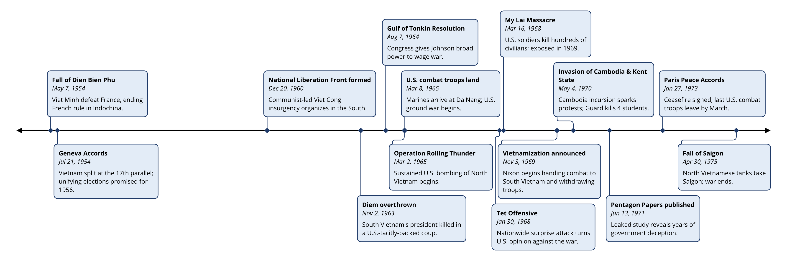

# timeliner

timeliner is a command-line tool that renders a timeline of dated events as a PNG. It was designed to be used by Claude and other AI agents, but people can use it too.



Claude made this image with timeliner. The whole request was *"Make a timeline of the most important 14 events in the Vietnam war."* Claude chose the events and wrote their descriptions.

## Install

You need Rust 1.89 or later. Then run:

```
cargo install --git https://github.com/hillegass/timeliner
```

Or clone this repository and run `cargo install --path .` inside it.

The fonts (Open Sans and Inconsolata) are built into the binary, so the same input gives the same image on every machine.

## Use

```
timeliner [--style=style.json] desc.json out.png
```

`desc.json` describes the events. A minimal file:

```json5
{
  events: [
    {label: "Shiloh", start: "1862-04-06"},
    {label: "Gettysburg", start: "1863-07-01"},
  ],
}
```

Use `-` for `desc.json` to read standard input, or for `out.png` to write the PNG to standard output.

- **Format:** both files are JSON5, so strict JSON works too.
- **Box text:** comes from a markdown template with fields, e.g. `"**{label}**\n\n{start}"`. Numbers take Python format specs (`{deaths:,d}`), and dates take strftime (`{start:%b %Y}`).
- **Dates:** years, year-months, dates, and date-times with or without time zones. BCE years are supported (`-0043` is 44 BCE).
- **Crowding:** boxes alternate above and below the line, and crowded events stack outward. Connectors jog sideways to avoid crossing each other.
- **Style file:** optional; controls size, colors, fonts, markers, and spacing.

The tool documents itself:

| Command | Prints |
|---|---|
| `timeliner --help` | a complete guide to both file formats |
| `timeliner --print-example` | a working description file (the [Civil War example](examples/civil-war.json5)) |
| `timeliner --print-default-style` | every style key with its default value, commented |
| `timeliner --schema desc` or `--schema style` | a JSON Schema for each file |

[`examples/`](examples/) has two worked examples: the Civil War example, and a phone-records timeline for a court case ([`murder.json`](examples/murder.json)) with a dark style ([`darkmode.json`](examples/darkmode.json)).

The image has no title; put the title and caption in the document that shows it.

## Use with Claude Code

Install the binary, then install the skill so Claude knows when and how to use it:

```
mkdir -p ~/.claude/skills/timeliner
cp skill/timeliner/SKILL.md ~/.claude/skills/timeliner/
```

Then ask Claude for a timeline. [`docs/TOOL_DESCRIPTION.md`](docs/TOOL_DESCRIPTION.md) has text for describing the tool to Claude in other settings, such as your own application's tool definitions.

## Development

```
cargo test       # unit, command-line, and golden-image tests
cargo clippy --all-targets
```

When you change the output on purpose, regenerate the reference images with `TIMELINER_UPDATE_GOLDEN=1 cargo test --test golden`, look at them, and commit them.

timeliner is built on Linebender's [vello_cpu](https://github.com/linebender/vello) (rendering) and [parley](https://github.com/linebender/parley) (text layout), with [pulldown-cmark](https://github.com/pulldown-cmark/pulldown-cmark) for markdown and [jiff](https://github.com/BurntSushi/jiff) for dates. The design notes are in [`docs/`](docs/).

## License

timeliner is licensed under either of

- Apache License, Version 2.0 ([LICENSE-APACHE](LICENSE-APACHE))
- MIT license ([LICENSE-MIT](LICENSE-MIT))

at your option.

The bundled fonts in [`assets/fonts/`](assets/fonts/) are licensed separately under the SIL Open Font License 1.1: Open Sans (© The Open Sans Project Authors) and Inconsolata (© The Inconsolata Project Authors). Their license texts are next to the font files, and `timeliner --licenses` prints them.

Unless you explicitly state otherwise, any contribution intentionally submitted for inclusion in timeliner by you, as defined in the Apache-2.0 license, shall be dual licensed as above, without any additional terms or conditions.
